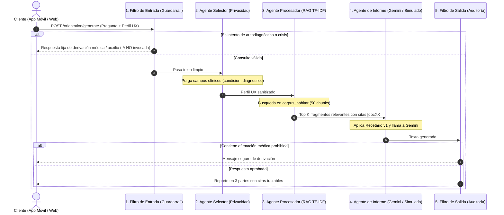

# Documentación Técnica del Backend: HabiTAR (Grupo 5 - GPI / UXLab)

**Fecha:** Noviembre de 2026  
**Línea de Trabajo:** TEA Screening Agent (RAG) en población adulta  
**Rama Oficial en GitHub:** `feature/backend-screening`  
**API Desplegada en la Nube:** [https://habitar-backend-odfe.onrender.com/docs](https://habitar-backend-odfe.onrender.com/docs)  
**Autor:** Patricio Vejar (para el equipo de desarrollo Grupo 5)

---

## 1. Introducción y Contexto del Proyecto

Para la entrega del **Hito 4**, el objetivo crítico era **dar por superada la fase de experimentación en Google Colab** y migrar toda la lógica del sistema a una **arquitectura backend real, modular y lista para producción** desarrollada con **FastAPI**.

El backend de HabiTAR tiene dos misiones fundamentales:
1. **Scoring Psicométrico Determinista:** Procesar los instrumentos de tamizaje (**CAT-Q** y **RBQ-2A**) mediante algoritmos matemáticos duros, garantizando un cálculo 100% libre de alucinaciones de IA.
2. **Orientación Psicoeducativa Trazable (RAG):** Administrar un sistema agéntico (*Tríada Agéntica*) que consulta una base de conocimiento documental clínica local y genera orientación personalizada citando fuentes explícitas (`[docXX#N]`).
3. **Guardarraíles Éticos y Legales:** Implementar una estricta política de **"Cero Diagnóstico"** que cumple con la **Ley N° 21.719 de Protección de Datos Personales** (privacidad por diseño y bloqueo de diagnósticos automatizados).

---

## 2. Estructura General del Código

El proyecto fue estructurado siguiendo las mejores prácticas de arquitectura en capas de FastAPI:

```text
backend/
├── app/
│   ├── api/
│   │   └── v1/
│   │       ├── endpoints/
│   │       │   ├── health.py        # Diagnóstico y estado del servicio
│   │       │   ├── screening.py     # Endpoint POST para scoring CAT-Q y RBQ-2A
│   │       │   └── orientation.py   # Endpoint POST para orientación con RAG agéntico
│   │       └── router.py            # Orquestador y centralizador de rutas v1
│   ├── core/
│   │   ├── config.py                # Ajustes y variables de entorno (pydantic-settings)
│   │   └── security.py              # Avisos legales y políticas de No-Diagnóstico
│   ├── schemas/
│   │   ├── health.py                # Modelos Pydantic del estado del sistema
│   │   ├── screening.py             # Modelos de entrada y salida para scoring
│   │   └── report.py                # Modelos de salida para orientación y citas
│   ├── services/
│   │   ├── scoring/                 # Módulo matemático determinista (Paso 2)
│   │   │   ├── catq.py              # Algoritmo de 25 ítems, 5 inversos y 3 subescalas
│   │   │   └── rbq2a.py             # Algoritmo de 20 ítems y cálculo de medias
│   │   ├── corpus/                  # Gestión de la base de conocimiento clínica
│   │   │   ├── chunker.py           # Segmentador de markdown en 50 fragmentos
│   │   │   └── retriever.py         # Motor de búsqueda semántica local (TF-IDF)
│   │   ├── guardrails/              # Filtros de seguridad ética
│   │   │   ├── input_filter.py      # Interceptación de 8 categorías adversariales y crisis
│   │   │   └── output_filter.py     # Auditoría de salida contra afirmaciones clínicas
│   │   ├── agents/                  # Tríada Agéntica (Recetario v1)
│   │   │   ├── prompts.py           # Regla 1 y directrices del sistema
│   │   │   ├── selector.py          # Agente Selector (purga de etiquetas médicas)
│   │   │   ├── procesador.py        # Agente Procesador (búsqueda RAG trazable)
│   │   │   └── informe.py           # Agente de Informe (generación controlada)
│   │   └── rag_pipeline.py          # Orquestador del ciclo completo de 4 capas
│   └── main.py                      # Punto de entrada de la aplicación FastAPI y CORS
├── corpus_habitar/                  # 10 documentos clínicos base segmentados
├── tests/                           # Suite de pruebas automatizadas (17 tests)
│   ├── test_health.py               # Tests de infraestructura
│   ├── test_scoring.py              # Tests matemáticos de CAT-Q y RBQ-2A
│   └── test_rag_pipeline.py         # Tests de RAG, guardarraíles y sanitización
├── .env.example                     # Plantilla de variables de entorno
├── requirements.txt                 # Dependencias del proyecto
└── README.md                        # Guía rápida de ejecución
```

---

## 3. Detalle Paso a Paso de las Funciones y Módulos Desarrollados

### PASO 1: Configuración Base y Servidor FastAPI

#### A. `app/core/config.py`
* **Propósito:** Centralizar la configuración de la aplicación de manera tipada y segura mediante `pydantic-settings`.
* **Variables Clave:**
  * `PROJECT_NAME`: `"HabiTAR TEA Screening API"`.
  * `API_V1_PREFIX`: `"/api/v1"`.
  * `GEMINI_API_KEY` y `GEMINI_MODEL`: Conexión opcional al modelo generativo. Si no se pasa clave, el backend entra automáticamente en **modo simulado**, lo que permite trabajar sin consumir tokens ni depender de internet.
  * `ALLOWED_ORIGINS`: Lista de dominios admitidos para **CORS**, permitiendo que la app móvil (Android) y entornos web consuman la API sin bloqueos de navegador.

#### B. `app/core/security.py`
* **Propósito:** Definir el texto del descargo de responsabilidad clínico que acompaña legalmente a cada resultado retornado:
  * `DISCLAIMER_CLINICO_NO_DIAGNOSTICO`: Especifica que HabiTAR es un instrumento de tamizaje orientativo y psicoeducativo, no apto para diagnósticos clínicos.
  * `REGLA_CERO_DIAGNOSTICO`: Regla madre que rige el comportamiento de todos los agentes.

#### C. `app/main.py`
* **Propósito:** Crear la instancia de FastAPI, aplicar el middleware de CORS, registrar el enrutador de la API v1 (`/api/v1`) y exponer el endpoint raíz `GET /`.
* **Swagger Automático:** Al levantar el servidor, FastAPI genera automáticamente la documentación interactiva en `/docs` (Swagger UI) y `/redoc`.

---

### PASO 2: Motor de Scoring Psicométrico Determinista (Sin IA)

> [!IMPORTANT]
> **Decisión de Arquitectura Crítica:**
> Los cálculos numéricos de los cuestionarios **NO se delegan al modelo de lenguaje (LLM)**. Si un LLM hace sumas o inversiones, puede sufrir alucinaciones numéricas. Todo el cálculo matemático se ejecuta de forma determinista y estricta en Python.

#### A. Módulo CAT-Q (`app/services/scoring/catq.py`)
El **CAT-Q** (*Camouflaging Autistic Traits Questionnaire*, Hull et al., 2019) evalúa estrategias de camuflaje social en adultos mediante 25 preguntas en escala Likert del 1 al 7 (*1 = Totalmente en desacuerdo, 7 = Totalmente de acuerdo*).

* **Constantes e Ítems Inversos:**
  ```python
  CATQ_TOTAL_ITEMS = 25
  COMPENSATION_ITEMS = {1, 4, 5, 8, 11, 14, 17, 20, 23}   # 9 ítems
  MASKING_ITEMS = {2, 6, 9, 12, 15, 18, 21, 24}          # 8 ítems
  ASSIMILATION_ITEMS = {3, 7, 10, 13, 16, 19, 22, 25}     # 8 ítems
  REVERSE_ITEMS = {3, 12, 19, 22, 24}                     # 5 ítems inversos
  ```
* **Función `calculate_catq_score(raw_answers: Dict[int, int]) -> CATQResponse`:**
  1. **Validación de Integridad:** Comprueba que vengan exactamente los 25 ítems y que cada valor esté en el rango $[1, 7]$. Si falta una pregunta o un valor es inválido (ej: `0` u `8`), lanza una excepción `ValueError`.
  2. **Inversión Determinista:** Para los ítems `3, 12, 19, 22 y 24`, calcula:
     $$\text{puntaje\_real} = 8 - \text{respuesta\_original}$$
     *(Por ejemplo, un 1 se convierte en 7; un 7 se convierte en 1; un 4 se mantiene en 4).*
  3. **Cálculo de Subescalas:**
     * **Compensación:** Suma de sus 9 ítems (rango 9–63).
     * **Enmascaramiento:** Suma de sus 8 ítems (rango 8–56).
     * **Asimilación:** Suma de sus 8 ítems (rango 8–56).
  4. **Puntaje Total:** Suma de los 25 ítems (rango 25–175). A mayor puntaje, mayor uso autorreportado de estrategias de camuflaje social.
  5. **Salida:** Retorna el modelo `CATQResponse` con el desglose y la nota descriptiva sin etiquetas diagnósticas.

#### B. Módulo RBQ-2A (`app/services/scoring/rbq2a.py`)
El **RBQ-2A** (*Adult Repetitive Behaviours Questionnaire-2*, Barrett et al., 2015) mide conductas e intereses repetitivos mediante 20 ítems.

* **Función `calculate_rbq2a_score(raw_answers: Dict[int, int]) -> RBQ2AResponse`:**
  1. **Validación y Normalización:** Valida que existan los 20 ítems. Si algún ítem viene en escala de 4 opciones, el valor `4` se mapea automáticamente a `3`, siguiendo el criterio de unificación psicométrica de Barrett et al.
  2. **Cálculo de Medias Aritméticas:**
     * **Media Total:** Suma de los 20 ítems dividida por 20 (rango 1.00 a 3.00).
     * **Conductas Motoras Repetitivas (RMB):** Media de los ítems `{1, 2, 4, 5, 6, 8}`.
     * **Insistencia en la Igualdad (IS):** Media de los ítems `{11, 12, 13, 14, 15, 16, 17, 18}`.
     * **Sensorimotoras (RSMB):** Ítems del 1 al 10.
  3. **Salida:** Retorna `RBQ2AResponse` redondeado a 2 decimales con su nota interpretativa.

#### C. Endpoint REST de Scoring (`app/api/v1/endpoints/screening.py`)
* **Ruta:** `POST /api/v1/screening/process`
* **Comportamiento:** Recibe un payload JSON con `user_id` y las respuestas de `catq` y/o `rbq2a`. Llama a las funciones matemáticas y, si los datos son inválidos, responde con código `400 Bad Request` indicando el motivo exacto del error.

---

### PASO 3: Pipeline RAG y Tríada Agéntica (Recetario v1)

El sistema de orientación opera mediante un **flujo estricto de 4 capas** diseñado para garantizar seguridad ética y trazabilidad científica:



#### A. Segmentación del Corpus (`app/services/corpus/chunker.py`)
* **Función `chunk_corpus(folder)`:**
  * Lee recursivamente los archivos `.md` de `corpus_habitar/`.
  * Extrae los metadatos YAML frontmatter (`id`, `titulo`, `tipo`, `origen`, `version`).
  * Divide el texto por encabezados (`#` y `##`).
  * Fusiona secciones demasiado cortas ($< 25$ palabras) y divide párrafos extensos ($> 220$ palabras).
  * **Resultado:** Produce exactamente **50 fragmentos estandarizados** a partir de los 10 documentos teóricos, cada uno con un identificador único (ej: `doc05_ficha_catq#1`).

#### B. Recuperador Semántico RAG (`app/services/corpus/retriever.py`)
* **Clase `CorpusRetriever`:**
  * Utiliza `TfidfVectorizer` de scikit-learn con un preprocesador que elimina acentos y normaliza texto en minúsculas en español (`normalize_text`).
  * **Costo Cero de Búsqueda:** No requiere llamadas a APIs de pago para vectorizar; la búsqueda semántica y el cálculo de similitud coseno se resuelven en memoria en menos de 5 milisegundos.
  * **Método `search(query, top_k=3, with_score=True)`:** Devuelve los $K$ fragmentos con mayor similitud a la consulta del usuario.

#### C. Filtros de Seguridad y Guardarraíles (`app/services/guardrails/`)
* **Filtro de Entrada (`input_filter.py`):**
  * Analiza la pregunta mediante expresiones regulares categorizadas en 8 áreas de riesgo: `autodiagnostico`, `pedir_diagnostico`, `tercera_persona`, `probabilidad`, `documento_clinico`, `inyeccion_o_fuga`, `consejo_medico` y `riesgo` (crisis/autolesión).
  * **Comportamiento:** Si un usuario pregunta: *"¿Tengo autismo según mis respuestas?"*, el filtro intercepta el mensaje y retorna `MENSAJE_DERIVACION` **sin consultar a Gemini**, eliminando de raíz cualquier riesgo clínico y ahorrando costos de API. Si detecta crisis, entrega inmediatamente números y recursos de apoyo.
* **Filtro de Salida (`output_filter.py`):**
  * Audita la respuesta antes de enviarla al usuario, verificando que no contenga frases que afirmen diagnósticos (*"tienes autismo"*, *"eres TEA"*, probabilidades diagnósticas o puntajes T del SRS-2).

#### D. Tríada Agéntica y Recetario v1 (`app/services/agents/`)
1. **Agente Selector (`selector.py`):**
   * Recibe el perfil UX del usuario y **purga campos clínicos sensibles** (`condicion`, `diagnostico`, `nivel_de_apoyo`). Cumple con la Ley N° 21.719 asegurando que ninguna etiqueta médica previa llegue al prompt del LLM.
2. **Agente Procesador (`procesador.py`):**
   * Invoca al recuperador RAG y formatea los fragmentos con su identificador formal (`[docXX#N]`) para forzar al modelo a citar solo información respaldada.
3. **Agente de Informe (`informe.py` y `prompts.py`):**
   * Inyecta las directrices de sistema del *Recetario v1*, obligando al modelo a responder bajo un formato de 3 secciones estrictas:
     1. **Lo que compartiste:** Resumen descriptivo de necesidades y estresores (sin juicios clínicos).
     2. **Orientación:** 1 a 3 estrategias prácticas citando las fuentes entre corchetes (ej: `[doc05_ficha_catq#2]`).
     3. **Alcance:** Límites del sistema y recordatorio de no-diagnóstico.

#### E. Orquestador del Pipeline (`app/services/rag_pipeline.py`)
* **Clase `RAGPipelineService`:**
  * Implementa el patrón *Singleton* (`get_instance()`) para mantener cargado el corpus y el vectorizador en memoria, evitando reindexar en cada petición HTTP.
  * Su método `run(query, user_profile, top_k)` conecta las 4 capas de forma fluida.

#### F. Endpoint REST de Orientación (`app/api/v1/endpoints/orientation.py`)
* **Ruta:** `POST /api/v1/orientation/generate`
* **Entrada:** `query` (pregunta), `user_profile` (arquetipo, estresores) y `screening_summary`.
* **Salida:** Respuesta estructurada, lista de fragmentos citados con su score de relevancia y el disclaimer legal obligatorio.

---

## 4. Batería de Pruebas Unitarias (`tests/`)

Para asegurar la robustez de la entrega, se implementaron **17 pruebas automatizadas** utilizando el módulo estándar `unittest` de Python:

| Archivo de Prueba | N° Tests | Qué valida |
| :--- | :---: | :--- |
| `test_health.py` | 2 | Disponibilidad de la raíz (`/`) y respuesta `200 OK` del healthcheck (`/health`). |
| `test_scoring.py` | 8 | Casos neutros (CAT-Q=100), inversión matemática en valores extremos (todos 1 dan 55, todos 7 dan 145), medias del RBQ-2A, normalización de escala 4 a 3 y validación de errores 400 por datos incompletos. |
| `test_rag_pipeline.py` | 7 | Carga exacta de los 50 fragmentos del corpus, búsqueda semántica, interceptación de autodiagnóstico en el filtro de entrada, auditoría del filtro de salida, sanitización de campos sensibles y llamadas E2E al endpoint `/orientation/generate`. |

**Comando de ejecución:**
```powershell
cd backend
py -m unittest discover tests
```
*Resultado:* **17 tests ejecutados en ~0.08 segundos con 100% de éxito (OK).**

---

## 5. Control de Versiones y Despliegue en la Nube (CI/CD)

1. **GitHub:**
   * Todo el backend, corpus, pruebas y documentación fueron subidos a la rama oficial:  
     👉 `feature/backend-screening` en el repositorio [pvejar-ops/HabiTAR-Grupo5](https://github.com/pvejar-ops/HabiTAR-Grupo5).
   * Se configuró el `.gitignore` para impedir que se suban entornos virtuales (`.venv`), archivos de compilación (`__pycache__`) o variables privadas (`.env`).
2. **Despliegue en Render:**
   * La aplicación se encuentra desplegada como un **Web Service gratuito en Render**, vinculado al repositorio.
   * Cualquier cambio pusheado a la rama activa se compila y publica automáticamente.
   * **Swagger UI en Vivo:** [https://habitar-backend-odfe.onrender.com/docs](https://habitar-backend-odfe.onrender.com/docs)

---

## 6. Guía Rápida para Levantar el Backend en Local

Si cualquier integrante del equipo desea clonar y ejecutar el servidor en su computadora:

```powershell
# 1. Clonar el repositorio y situarse en la rama del backend
git clone -b feature/backend-screening https://github.com/pvejar-ops/HabiTAR-Grupo5.git
cd HabiTAR-Grupo5/backend

# 2. Instalar dependencias
pip install -r requirements.txt

# 3. Ejecutar las pruebas unitarias para verificar el entorno
py -m unittest discover tests

# 4. Iniciar el servidor local
py -m uvicorn app.main:app --reload --port 8000
```

Una vez iniciado, pueden abrir su navegador en:
* Documentación interactiva: `http://localhost:8000/docs`
* Healthcheck: `http://localhost:8000/api/v1/health`
