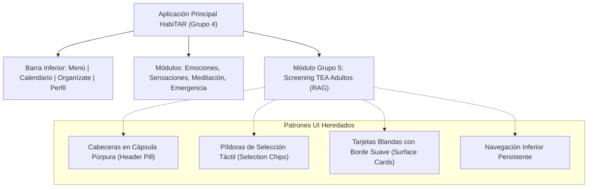
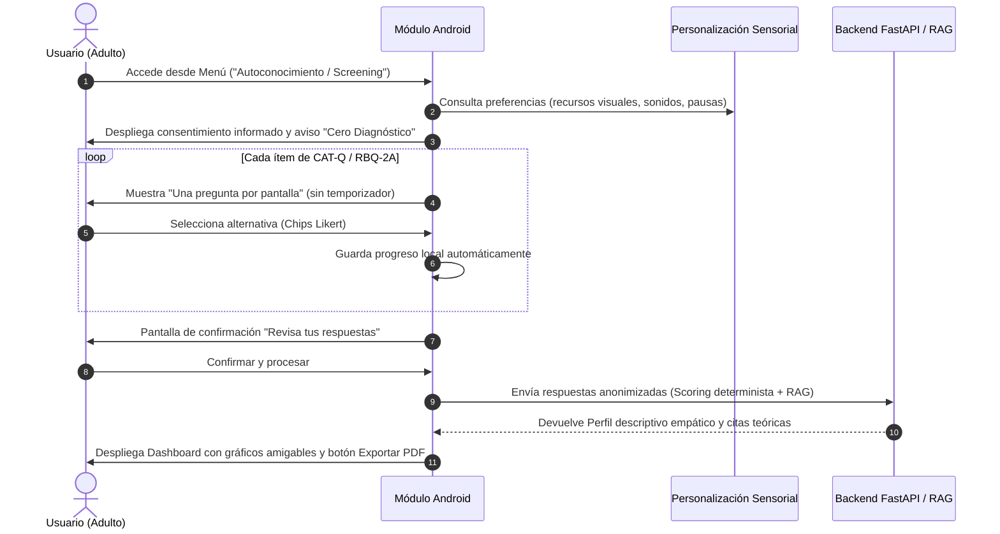

# Sistema de Diseño e Integración Frontend: Módulo Adultos HabiTAR

**Proyecto:** HabiTAR – Módulo de Screening TEA en Adultos (Grupo 5 - GPI / UTEM / UXLab)  
**Referencia base:** Aplicación principal Android HabiTAR (Grupo 4 / Observatorio UX para la inclusión)  
**Fecha de consolidación:** Octubre 2026  
**Objetivo:** Definir los lineamientos visuales, componentes de interfaz y arquitectura frontend en Android Studio (Jetpack Compose / Kotlin), garantizando una **integración 100% armónica y nativa con la aplicación anfitriona de HabiTAR**, cumpliendo con los estándares de accesibilidad neurodivergente y el marco ético de *Cero Diagnóstico*.

---

## 1. Mapeo de la Identidad Visual de la Aplicación Principal

A partir del análisis del prototipo funcional, wireframes y especificaciones del repositorio compartido (`GPI - HabiTAR Grupo 5` / `2-Habitar 2do Equipo`), se extraen los patrones visuales consolidados de HabiTAR:



### Elementos Gráficos Nucleares de HabiTAR:
1. **Identidad de Marca:** Logotipo `Habi` (azul cielo suave `#4A90E2`) y `TAR` (púrpura índigo `#6C63FF`), con tipografía sans-serif redondeada y amigable.
2. **Cabeceras de Pantalla (*Capsule Header*):** Cápsula horizontal redondeada en la parte superior con fondo morado/violeta (`#6750A4` / `#6C63FF`) y texto blanco centrado, acompañada de botón de retroceso (`arrow_back`) a la izquierda.
3. **Botones de Acción Primaria (*Action Pills*):** Botón estilo píldora alargada con esquinas totalmente redondeadas (`border-radius: 28dp`), fondo morado primario y tipografía blanca en mayúsculas (`COMENZAR`, `TODO LISTO`, `INICIAR SESIÓN`).
4. **Píldoras de Selección de Alternativas (*Chips*):** Botones en píldora con fondo suave que se activan al tacto (como en la selección de emociones: *Feliz*, *Triste*, *Confundido*; o sensaciones físicas: *Taquicardia*, *Tensión muscular*).
5. **Navegación Inferior (*Bottom Navigation Bar*):** 4 pestañas universales:
   - 🏠 **Menú:** Módulos principales de autorregulación y screening.
   - 📅 **Calendario:** Control y registro temporal.
   - ✏️ **Organízate:** Lista de tareas y agenda adaptada.
   - 👤 **Perfil:** Datos de usuario, configuración sensorial e historial de respuestas.

---

## 2. Paleta Cromática y Tokens del Sistema

Para que el módulo de adultos pertenezca a la misma familia visual que la app anfitriona sin desentonar, se adopta su sistema de color añadiendo la semántica propia de evaluación:

```
[ Paleta Base App Principal ]
  Primario Brand:        #6C63FF (Púrpura HabiTAR)
  Fondo General:         #F8F9FE (Blanco lavanda ultra suave)
  Superficies (Cards):   #FFFFFF (Blanco puro con sutil contorno #E2E8F0)
  Texto Primario:        #1E293B (Gris pizarra oscuro)
  Texto Secundario:      #64748B (Gris neutro)

[ Paleta de Módulos Existentes en HabiTAR ]
  Módulo Emociones:      #E879F9 (Rosa / Magenta pastel)
  Módulo Sensaciones:    #818CF8 (Azul periwinkle)
  Módulo Meditación:     #34D399 (Verde menta)
  Módulo Emergencia:     #FB7185 (Coral cálido suave)

[ Nuevo Módulo: Screening / Autoconocimiento Adultos (Grupo 5) ]
  Color Identitario:     #5E72E4 / #4F46E5 (Añil reflexivo)
  Acento de Validación:  #6C9A8B (Verde salvia calmante)
```

### Política Cromática de "Baja Alarma" en Resultados:
Siguiendo las directrices del Comité de Ética y el Benchmark GOV.UK/NHS, **nunca se utilizará el color rojo o verde semafórico** para calificar la compatibilidad del usuario:
*   *Baja afinidad:* Tono gris lavanda (`#798E9C`).
*   *Afinidad moderada:* Tono ocre / ámbar suave (`#D99B43`).
*   *Alta afinidad con rasgos:* Tono violeta añil relajante (`#5E5A80`).

---

## 3. Experiencia de Usuario (UX) para el Módulo de Evaluación

El documento *Benchmark y Contraste con HabiTAR* y las minutas de reunión con el Dr. Erwin Aguirre y UXLab definen las reglas de oro de este flujo:



### Reglas UX Críticas Implementadas:
1. **Regla de "Una sola cosa por página" (Estándar NHS/GOV.UK):**
   - Una única pregunta activa en el centro de la pantalla para evitar sobrecarga sensorial.
   - Enunciado claro en tipografía legible (18sp, Regular/Medium).
   - Botón discreto de ayuda contextual `(?)` que aclara términos ambiguos del CAT-Q o RBQ-2A con ejemplos de la vida diaria (estudio superior / laboral).
2. **Control del Ritmo y Cero Ansiedad:**
   - **Prohibición absoluta de cronómetros o tiempos límite.**
   - Indicador de progreso predecible: `Pregunta 7 de 25` con barra segmentada suave.
   - Guardado automático en tiempo real: el usuario puede salir de la app en cualquier momento y al volver retomará en la misma pregunta.
   - Botón secundario siempre accesible: *"Guardar y continuar más tarde"*.
3. **Pantalla de Confirmación Previa:**
   - Antes de enviar el cuestionario al Agente RAG, se presenta una pantalla resumen (*"Revisa tus respuestas"*) que permite modificar cualquier ítem sin tener que reiniciar el test.

---

## 4. Componentes Visuales del Módulo

### A. Pantalla de Acceso al Módulo (Integrada en la App Base)
*   **Ubicación:** Disponible como una tarjeta principal en el **Menú de Autorregulación** (junto a *Emociones*, *Sensaciones*, *Meditación* y *Emergencia*), o accesible mediante la pestaña **Perfil** en la sección *"Mis informes"*.
*   **Diseño de la Card:** Misma geometría redondeada (`shape = RoundedCornerShape(16.dp)`) con gradiente añil suave y el título:  
    **"Autoconocimiento y Screening TEA"**  
    *Subtítulo:* "Instrumentos validados (CAT-Q y RBQ-2A) para explorar tus rasgos y patrones con apoyo de IA."

### B. Selector de Escala Likert (Componente `HabitarLikertSelector`)
*   Se reutiliza el patrón de los botones redondeados de la app principal.
*   En lugar de radio-buttons pequeños y difíciles de presionar, cada opción es un botón alargado (*Pill Chip* horizontal) de altura mínima 52dp:
    *   *Totalmente en desacuerdo*
    *   *En desacuerdo*
    *   *Ligeramente en desacuerdo*
    *   *Neutral*
    *   *Ligeramente de acuerdo*
    *   *De acuerdo*
    *   *Totalmente de acuerdo*
*   El botón seleccionado adopta el color primario de la app (`#6C63FF`) con texto en blanco y una suave animación de confirmación.

### C. Visualización de Resultados e Informe Agéntico
Siguiendo el diseño de la pestaña *Historial del Usuario Desplegado* de la app principal:
1. **Encabezado de Resguardo Clínico:**
   > *"Este informe describe patrones en tus respuestas en comparación con literatura científica. **No es un diagnóstico clínico**. Te recomendamos compartirlo con un profesional de la salud acreditado."*
2. **Dashboard de Subescalas (Gráficos Simples y Comprensibles):**
   - **Camuflaje Social (CAT-Q):** Barras horizontales limpias desglosando *Compensación*, *Enmascaramiento* y *Asimilación*.
   - **Conductas e Intereses Repetitivos (RBQ-2A):** Desglose de *Rutinas*, *Intereses sensoriales* y *Conductas motoras*.
3. **Cuerpo del Informe Redactado por el Agente de Informe (Gemini):**
   - Organizado en tarjetas colapsables (*Accordions* tipo *"Ver más"*, exactamente igual al historial de HabiTAR) para que el usuario no enfrente un muro denso de texto y pueda leer a su ritmo.
4. **Acción Principal:**
   - Botón píldora: `DESCARGAR INFORME EN PDF` (para llevar a consulta psicológica o psiquiátrica).

---

## 5. Arquitectura Técnica Frontend (Jetpack Compose / Android)

Para que el Grupo 5 entregue un código modular que el Grupo 4 pueda ensamblar sin fricciones:

### Estructura de Paquetes Recomendada:
```
com.habitar.app.feature.screening/
├── presentation/
│   ├── components/
│   │   ├── HabitarTopHeader.kt       // Cápsula superior con botón Volver
│   │   ├── HabitarLikertSelector.kt  // Píldoras de opciones táctiles
│   │   ├── ScreeningProgressBar.kt   // Barra de avance predecible
│   │   └── DimensionBarChart.kt      // Visualizador gráfico de subescalas
│   ├── viewmodel/
│   │   └── ScreeningViewModel.kt     // Maneja estado, autoguardado y llamadas a API
│   ├── ScreeningIntroScreen.kt       // Consentimiento y política no diagnóstico
│   ├── QuestionnaireScreen.kt        // Regla 1 pregunta por página
│   ├── ReviewAnswersScreen.kt        // Revisión previa GOV.UK
│   └── ScreeningResultScreen.kt      // Dashboard de resultados y RAG Report
├── data/
│   ├── remote/
│   │   └── ScreeningApiService.kt    // Interfaz Retrofit hacia FastAPI Grupo 5
│   └── model/
│       ├── QuestionnaireDto.kt
│       └── ScreeningResultDto.kt
```

### Contrato de Tema (`HabitarTheme`):
El módulo consumirá directamente el `MaterialTheme` de la aplicación principal, asegurando que si el usuario activa el modo oscuro o modifica las preferencias sensoriales en el módulo de personalización inicial (*Cuéntanos de ti*), el screening adopte automáticamente los mismos contrastes y fuentes.

---

## 6. Próximos Pasos de Coordinación

1. **Compartir los contratos de interfaz (DTOs)** con el Grupo 4 para validar las llamadas entre la UI Android y los endpoints de FastAPI.
2. **Presentar estos mockups** en la próxima reunión con el Dr. Erwin Aguirre y en la revisión con Carolina Da Silva (Mercado Libre) como evidencia de madurez de diseño y trazabilidad técnica.
